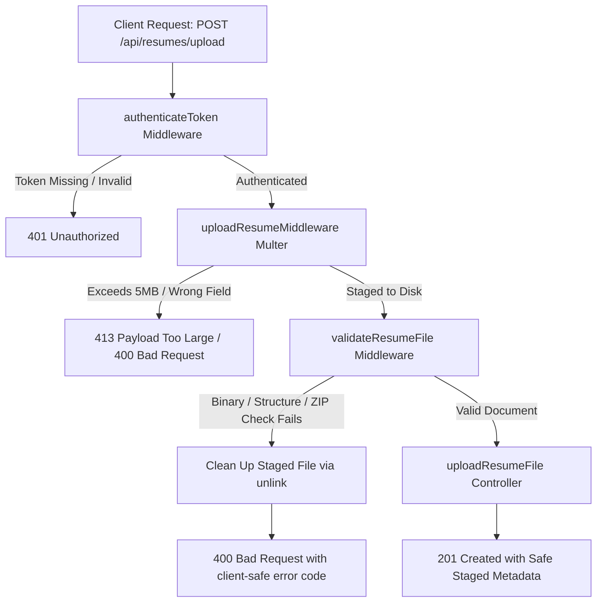

# Module 4 – Lesson 4.3: PDF and DOCX File Validation

## 1. Executive Summary
This document provides complete architectural, security, and operational documentation for **Module 4 – Lesson 4.3: PDF and DOCX File Validation** in the AI Resume Analyzer application.

The file validation layer sits directly behind Multer upload staging and enforces deep document structural inspection before files are accepted, parsed, or processed downstream. The backend verifies actual binary magic bytes, OpenXML ZIP package structure, and readable PDF tree objects rather than trusting client-supplied file extensions or MIME headers.

---

## 2. Dependencies Used
All dependencies integrate with the Node.js ES module (`"type": "module"`) architecture:

| Package | Version | Purpose in Validation Pipeline |
| :--- | :--- | :--- |
| `file-type` | `^21.3.0` | Inspects binary buffers from disk to detect true file types (e.g. detecting masqueraded JPEG, PNG, or EXE files). |
| `pdf-parse` | `^2.4.5` | Parses PDF documents using `PDFParse` class to verify readable page objects, detect encryption/passwords, and identify corrupted xref/trailers. |
| `yauzl` | `^3.2.1` | Performs non-extracting streaming inspection of DOCX ZIP containers, entry paths, and compression ratios with `lazyEntries: true`. |
| `multer` | `^2.5.0` | Initial multipart stream handling, 5 MB file size limit enforcement, and private staging storage. |
| `zlib` | Built-in | Node.js native zlib used in test fixture generation for deflate verification. |

---

## 3. PDF Validation Architecture & Process

### 3.1 Binary Signature (Magic Bytes)
- **Signature**: Every valid PDF document must begin with the ASCII sequence `%PDF-`.
- **Hexadecimal**: `25 50 44 46 2D`.
- **Enforcement**: [backend/services/fileValidationService.js](file:///c:/Users/Admin/Desktop/AI_Resume_Analyzer/backend/services/fileValidationService.js) uses a low-overhead file descriptor stream (`fs.promises.open`) to inspect the first 5 bytes without buffering the whole file if the signature is invalid.

### 3.2 Structure & Parser Verification
- The full file buffer is read into memory and passed to `new PDFParse({ data: fileBuffer })`.
- `await parser.load()` attempts to parse the document tree.
- **Empty Document Handling**: Rejects files with 0 bytes or `doc.numPages <= 0` with `EMPTY_DOCUMENT` or `EMPTY_PDF_PAGES`.
- **Encrypted / Password-Protected Policy**: Password-protected PDFs cannot be analyzed by the AI resume engine. Encrypted files throw `PasswordException` and are rejected with a clear user prompt:
  > *"Password-protected and encrypted PDF files are not supported. Please remove the password and try again."*
- **Corruption Handling**: Broken xref tables, missing trailers, or truncated streams trigger `InvalidPDFException` or `FormatError` and return `CORRUPTED_PDF` (HTTP 400).
- **Resource Management**: Parser resources are destroyed in a `finally` block (`await parser.destroy()`).

---

## 4. DOCX Validation Architecture & Process

DOCX documents are Office Open XML archives based on the ZIP container format.

### 4.1 Magic Bytes & Format Separation
- **Legacy Word (.doc) Rejection**: Old Word 97-2003 binary formats start with OLE2 / Compound File Binary Format magic bytes `D0 CF 11 E0 A1 B1 1A E1`. If detected, they are immediately rejected with:
  > *"Legacy .doc (Word 97-2003) binary files are not supported. Please save or convert your resume to modern .docx format."*
- **ZIP Signature**: DOCX files must start with the standard ZIP local file header signature `PK\x03\x04` (`50 4B 03 04`).

### 4.2 Non-Extracting Streaming ZIP Inspection
Rather than extracting untrusted ZIP archives onto the server filesystem, `yauzl.open` is invoked with `{ lazyEntries: true, autoClose: true }`:
- Entries are read sequentially one-by-one (`zipfile.readEntry()`) from the ZIP central directory table.
- No entry payloads are decompressed onto disk.
- **Required OpenXML Parts**:
  - `[Content_Types].xml`: Verified to exist in the archive root.
  - `word/document.xml`: Verified to contain the main document content stream.
  - If either required part is missing, the upload is rejected with HTTP 400 (`MISSING_DOCX_CONTENT_TYPES` or `MISSING_DOCX_DOCUMENT_XML`).

---

## 5. ZIP Security & ZIP Bomb Defense Limits

To defend against decompression bombs, path traversal attacks, and denial-of-service, the following strict bounds are enforced during streaming inspection:

| Limit Parameter | Threshold | Attack Vector Mitigated |
| :--- | :--- | :--- |
| **Max ZIP Entries** | `500 entries` | Entry flood / denial of service via central directory exhaustion. |
| **Max Uncompressed Size** | `25 MB` (26,214,400 bytes) | High compression ratio ZIP bombs (e.g., gigabyte decompression). |
| **Max Compression Ratio** | `100:1` (for entries > 1 KB) | Decompression bomb recursion and anomalous expansion attacks. |
| **Path Traversal Protection** | Rejects `..`, `../`, `..\` | Directory traversal writing outside target directories. |
| **Absolute Path Rejection** | Rejects `/`, `\`, `C:\` | Overwriting system files or writing to absolute drive locations. |
| **Null Byte Protection** | Rejects `\0` | Null byte poison attacks targeting C-based file system bindings. |

If any entry violates these limits, `zipfile.close()` is invoked immediately and the request is aborted with HTTP 400 (`ZIP_BOMB_LIMIT_EXCEEDED` or `UNSAFE_ARCHIVE_ENTRY`).

---

## 6. MIME Type and Extension Harmonization

1. **Extension Normalization**: `path.extname(filename).toLowerCase()` normalizes the extension. Only `.pdf` and `.docx` are allowed.
2. **Declared MIME Cross-Check**:
   - `.pdf` must have `application/pdf`.
   - `.docx` must have `application/vnd.openxmlformats-officedocument.wordprocessingml.document` (or client-tolerated `application/msword`).
3. **Binary Content Cross-Check**:
   - `file-type` analyzes file headers. If an executable (`.exe`, `.dll`, `.elf`) or image (`.jpg`, `.png`, `.gif`, `.webp`) was renamed to `.pdf` or `.docx`, it is rejected with `FILE_TYPE_MISMATCH`:
   > *"File content does not match the .pdf extension. Detected binary type: jpg (image/jpeg)."*

---

## 7. Invalid File Cleanup Policy

- **Isolation**: Staged files are written to `backend/uploads/resumes/` with cryptographically randomized filenames (`resume-<timestamp>-<hex16>.<ext>`).
- **Immediate Cleanup on Failure**:
  If any validation check fails (magic bytes, parser, ZIP structure, bomb limit, path traversal), `safeCleanupStagedFile` is called immediately in [backend/middleware/validateResumeFile.js](file:///c:/Users/Admin/Desktop/AI_Resume_Analyzer/backend/middleware/validateResumeFile.js).
- **Path Confinement Verification**:
  `safeCleanupStagedFile` resolves `req.file.path` and verifies that `resolvedPath.startsWith(resolvedUploadDir)` before calling `fs.promises.unlink()`. Untrusted client paths are never passed to file system deletion operations.
- **Valid Files**:
  Files passing all validation checks remain staged in `backend/uploads/resumes/` for subsequent parsing (Lesson 4.4) and database linking.

---

## 8. Middleware Execution Pipeline

---

## 9. Security Limitations & Antivirus Status
> [!IMPORTANT]
> **Antivirus Scanning Status: Not Implemented (Document Validation Only)**
> The validation layer performs deep structural document parsing, magic bytes verification, and ZIP bomb mitigation. However, **binary antivirus/malware scanning (e.g., ClamAV, VirusTotal API, or Windows Defender integration) is NOT currently implemented**.
>
> **Known Limitations**:
> 1. Advanced embedded macro payloads (VBA macros in OpenXML `.docm` format are rejected, but standard DOCX XML macros are not scanned by an AV engine).
> 2. PDF zero-day exploits targeting PDF rendering engines.
> 3. Production deployments should attach a dedicated ClamAV daemon (`clamd`) or AWS GuardDuty / cloud virus scanning hook prior to permanent storage.

---

## 10. Test Execution Results

All 21 required test cases were executed against live endpoints in [backend/tests/resumeFileValidation.test.js](file:///c:/Users/Admin/Desktop/AI_Resume_Analyzer/backend/tests/resumeFileValidation.test.js):

| # | Test Case Scenario | HTTP Code | Result |
| :-: | :--- | :-: | :-: |
| 1 | Valid PDF document accepted | `201 Created` | **PASS** |
| 2 | Valid DOCX document accepted | `201 Created` | **PASS** |
| 3 | JPG renamed as PDF rejected | `400 Bad Request` | **PASS** |
| 4 | PNG renamed as DOCX rejected | `400 Bad Request` | **PASS** |
| 5 | Invalid PDF magic bytes rejected | `400 Bad Request` | **PASS** |
| 6 | Invalid/truncated ZIP archive rejected | `400 Bad Request` | **PASS** |
| 7 | ZIP missing `[Content_Types].xml` rejected | `400 Bad Request` | **PASS** |
| 8 | ZIP missing `word/document.xml` rejected | `400 Bad Request` | **PASS** |
| 9 | Corrupted PDF document structure rejected | `400 Bad Request` | **PASS** |
| 10 | Empty PDF file (0 bytes) rejected | `400 Bad Request` | **PASS** |
| 11 | Empty DOCX file (0 bytes) rejected | `400 Bad Request` | **PASS** |
| 12 | MIME type mismatch rejected | `400 Bad Request` | **PASS** |
| 13 | Extension mismatch (.exe, .txt) rejected | `400 Bad Request` | **PASS** |
| 14 | Oversized file (> 5 MB) rejected | `413 Payload Too Large` | **PASS** |
| 15 | Excessive ZIP entry count (> 500) rejected | `400 Bad Request` | **PASS** |
| 16 | Excessive uncompressed ZIP size (> 25 MB) rejected | `400 Bad Request` | **PASS** |
| 17 | Path traversal archive entry (`word/../../evil.xml`) rejected | `400 Bad Request` | **PASS** |
| 18 | Invalid staged file is immediately unlinked from disk | Disk Count Unchanged | **PASS** |
| 19 | Valid file remains available on disk for next lesson | File Exists | **PASS** |
| 20 | Unauthenticated request rejected before file validation | `401 Unauthorized` | **PASS** |
| 21 | Existing valid upload workflow preserved without path exposure | `201 Created` | **PASS** |

### Regression & Build Verification
- **Backend Complete Test Suite**: 86 passing tests across 8 test suites.
- **Frontend Validation Test Suite**: 16 passing tests.
- **Frontend Production Build**: Vite compiled successfully (`dist/assets/index-*.js`, 0 errors).
