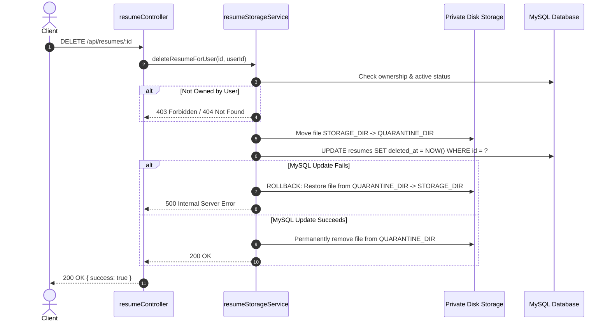

# Module 4 – Lesson 4.5: Resume List, Preview & Delete

## 1. Executive Summary
This document specifies the technical implementation, architectural design, security controls, and test results for **Module 4 – Lesson 4.5: Resume List, Preview & Delete** in the AI Resume Analyzer application.

Authenticated users can securely:
1. List their own uploaded resumes with pagination and metadata.
2. Preview PDF documents inline in the browser via streaming with range request support.
3. Handle DOCX files via a clean fallback workflow (since web browsers do not natively render OpenXML DOCX binaries).
4. Download original resume files with header-injection-safe disposition filenames.
5. Soft-delete resumes with private file quarantine and database rollback protection, preserving data integrity across foreign-key dependent analysis history records.

---

## 2. API Endpoints Specification

### 2.1 List Resumes
- **Endpoint**: `GET /api/resumes`
- **Authentication**: Required (`token` HttpOnly session cookie).
- **Query Parameters**:
  - `page`: Page number (integer $\ge 1$, defaults to 1).
  - `limit`: Items per page (integer between 1 and 50, defaults to 10).
- **Response Status**: `HTTP 200 OK`
- **Example Response**:
```json
{
  "success": true,
  "data": {
    "resumes": [
      {
        "id": 105,
        "resumeId": 105,
        "title": "Alex_Developer_Resume",
        "candidateName": "Alex Developer",
        "originalFilename": "Alex_Developer_Resume.pdf",
        "mimeType": "application/pdf",
        "fileType": "pdf",
        "fileSize": 245760,
        "status": "uploaded",
        "createdAt": "2026-11-25T09:28:00.000Z",
        "updatedAt": "2026-11-25T09:28:00.000Z"
      }
    ],
    "pagination": {
      "total": 1,
      "page": 1,
      "limit": 10,
      "totalPages": 1
    }
  }
}
```

### 2.2 Preview Resume
- **Endpoint**: `GET /api/resumes/:resumeId/preview`
- **Authentication**: Required (`token` HttpOnly session cookie).
- **Behavior**:
  - **PDF Documents**: Streamed inline via `fs.createReadStream()`.
    - Headers:
      - `Content-Type: application/pdf`
      - `Content-Disposition: inline; filename="sanitized.pdf"; filename*=UTF-8''sanitized.pdf`
      - `X-Content-Type-Options: nosniff`
      - `Cache-Control: private, no-store, no-cache, must-revalidate`
      - `Accept-Ranges: bytes`
    - Supports `Range: bytes=start-end` returning `HTTP 206 Partial Content`.
  - **DOCX Documents**: Browsers do not support native DOCX rendering. Returns `HTTP 400 Bad Request` with structured download fallback metadata:
    ```json
    {
      "success": false,
      "message": "DOCX files cannot be previewed natively in the browser. Please use the download option to view this document.",
      "fallbackAction": "download",
      "downloadUrl": "/api/resumes/105/download",
      "fileType": "docx",
      "originalFilename": "Alex_Profile.docx"
    }
    ```

### 2.3 Download Resume
- **Endpoint**: `GET /api/resumes/:resumeId/download`
- **Authentication**: Required (`token` HttpOnly session cookie).
- **Behavior**: Streamed as an attachment.
- **Headers**:
  - `Content-Type: <verified_mime_type>`
  - `Content-Length: <file_size>`
  - `Content-Disposition: attachment; filename="sanitized.pdf"; filename*=UTF-8''sanitized.pdf`
  - `X-Content-Type-Options: nosniff`
  - `Cache-Control: private, no-store`

### 2.4 Delete Resume
- **Endpoint**: `DELETE /api/resumes/:resumeId`
- **Authentication**: Required (`token` HttpOnly session cookie + CSRF header).
- **Strategy**: Soft delete in MySQL with atomic file quarantine.
- **Response Status**: `HTTP 200 OK`
- **Example Response**:
```json
{
  "success": true,
  "message": "Resume deleted successfully",
  "deletedId": 105
}
```

---

## 3. Authentication & Ownership Isolation

1. **Server-Side Identity Truth**:
   The user ID is extracted strictly from `req.user.id` (cryptographically validated JWT cookie). Client-provided IDs in query parameters or request bodies are completely ignored.
2. **Cross-Tenant Attack Defense**:
   Every database query filters by `WHERE resume_id = ? AND user_id = ? AND deleted_at IS NULL`.
   If a user requests a resume ID belonging to another user, the server verifies existence under other tenants and responds with `HTTP 403 Forbidden` (`"Access denied: you do not own this resource"`).

---

## 4. Delete Strategy: Soft Delete & File Consistency

### 4.1 Why Soft Delete?
The MySQL schema defines foreign keys on `resumes.resume_id` from 6 dependent tables:
- `analysis_history`
- `resume_analyses`
- `resume_scores`
- `job_matches`
- `generated_resumes`
- `resume_versions`

Hard deleting rows in `resumes` would either fail due to foreign key constraints or destroy audit history and score records.
Instead:
- The database record is marked with `deleted_at = NOW()` and `status = 'failed'`.
- All list, preview, download, and dashboard queries filter `AND r.deleted_at IS NULL`.
- The resume immediately disappears from user views while preserving analytics integrity.

### 4.2 File Quarantine and Rollback Workflow


---

## 5. Frontend Components

| Component | Path | Purpose |
| :--- | :--- | :--- |
| `MyResumes` | `frontend/src/pages/dashboard/MyResumes.jsx` | Full page listing resumes with document badges, sizes, upload dates, pagination, and action buttons. |
| `PdfPreviewModal` | `frontend/src/components/resumes/PdfPreviewModal.jsx` | Modal rendering PDF blobs inline via an iframe, with loading indicators, error recovery, safe blob cleanup (`URL.revokeObjectURL`), and clear DOCX download fallback notice. |
| `DeleteResumeDialog` | `frontend/src/components/resumes/DeleteResumeDialog.jsx` | Confirmation dialog showing the document name before triggering soft-delete. |
| `resumeService` | `frontend/src/services/resumeService.js` | Added `getAllResumes`, `previewResumePdf`, `downloadResume`, and `deleteResume` helpers. |
| `AppRoutes` | `frontend/src/routes/AppRoutes.jsx` | Replaced placeholder route `/resumes` with the live `<MyResumes />` page. |

---

## 6. Test Execution Results

All 31 backend scenarios (34 assertions) were executed in [backend/tests/resumeListPreviewDelete.test.js](file:///c:/Users/Admin/Desktop/AI_Resume_Analyzer/backend/tests/resumeListPreviewDelete.test.js):

| Section | Cases | Status |
| :--- | :--- | :---: |
| **Resume List** | Cases 1–6: Own resumes, multi-tenant isolation, pagination, invalid pagination normalization, empty list, unauthenticated 401 | **PASS** |
| **Preview** | Cases 7–14: PDF inline preview, range request 206, cross-tenant 403, invalid ID 400, missing record 404, missing file 404, path traversal block, DOCX fallback 400, path secrecy | **PASS** |
| **Download** | Cases 15–20: PDF download, DOCX download, filename header injection sanitization, cross-tenant 403, missing file 404, streaming verification | **PASS** |
| **Delete** | Cases 21–27: User soft-delete, cross-tenant delete 403, DB failure rollback restore, physical file cleanup, missing physical file handling, preservation of linked `analysis_history`, repeated deletion 404 | **PASS** |
| **Regression** | Cases 28–31: Upload, validation, authentication, and dashboard route regression | **PASS** |

### Complete Test Run Summary:
- **Backend Suites**: 10 test suites, **151 tests passed**, 0 failed.
- **Frontend Validation**: 16 tests passed, 0 failed.
- **Frontend Production Build**: Vite compiled successfully (`dist/assets/index-*.js`, 0 errors).
