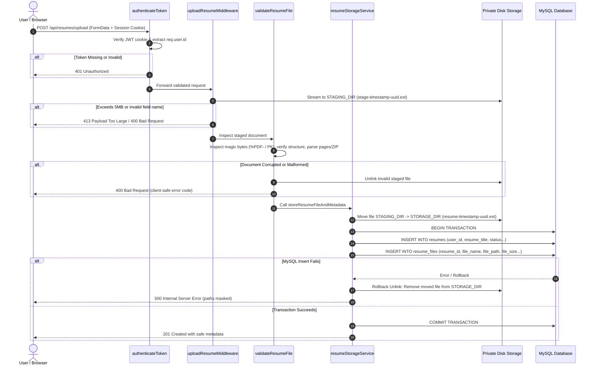

# Module 4 – Lesson 4.4: Resume Storage & Database Integration

## 1. Executive Summary
This document specifies the technical implementation, architectural patterns, database schemas, and verification results for **Module 4 – Lesson 4.4: Resume Storage & Database Integration** of the AI Resume Analyzer application.

When an authenticated user uploads a valid PDF or DOCX resume, the file is:
1. Received and staged to temporary private disk storage via Multer.
2. Validated for true binary signatures (`%PDF-` / `PK\x03\x04`), OpenXML tree structures, and safe compression ratios.
3. Moved from staging to private long-term application storage (`backend/uploads/resumes/`) using a server-generated randomized filename.
4. Recorded within an atomic MySQL database transaction across the `resumes` and `resume_files` tables.
5. Protected by compensating rollback cleanup: if database insertion fails after moving the physical file, the moved file is immediately deleted to prevent orphaned files.

---

## 2. Database Schema & Migration Reference

The application database schema leverages a normalized design separating the logical resume entity (`resumes`) from its physical stored files (`resume_files`).

### 2.1 Schema Definition SQL

```sql
-- Logical Resume Entity
CREATE TABLE IF NOT EXISTS `resumes` (
  `resume_id` BIGINT NOT NULL AUTO_INCREMENT,
  `user_id` BIGINT NOT NULL,
  `resume_title` VARCHAR(200) COLLATE utf8mb4_unicode_ci DEFAULT NULL,
  `candidate_name` VARCHAR(150) COLLATE utf8mb4_unicode_ci DEFAULT NULL,
  `extracted_text` LONGTEXT COLLATE utf8mb4_unicode_ci,
  `status` ENUM('uploaded','processing','completed','failed') COLLATE utf8mb4_unicode_ci DEFAULT 'uploaded',
  `created_at` TIMESTAMP NULL DEFAULT CURRENT_TIMESTAMP,
  `updated_at` TIMESTAMP NULL DEFAULT CURRENT_TIMESTAMP ON UPDATE CURRENT_TIMESTAMP,
  `deleted_at` TIMESTAMP NULL DEFAULT NULL,
  PRIMARY KEY (`resume_id`),
  KEY `idx_resumes_user` (`user_id`),
  KEY `idx_resumes_status` (`status`),
  CONSTRAINT `resumes_ibfk_1` FOREIGN KEY (`user_id`) REFERENCES `users` (`user_id`) ON DELETE RESTRICT ON UPDATE CASCADE
) ENGINE=InnoDB DEFAULT CHARSET=utf8mb4 COLLATE=utf8mb4_unicode_ci;

-- Physical Resume Document Storage
CREATE TABLE IF NOT EXISTS `resume_files` (
  `file_id` BIGINT NOT NULL AUTO_INCREMENT,
  `resume_id` BIGINT NOT NULL,
  `file_name` VARCHAR(255) COLLATE utf8mb4_unicode_ci NOT NULL,
  `file_path` VARCHAR(500) COLLATE utf8mb4_unicode_ci NOT NULL,
  `file_type` ENUM('pdf','doc','docx') COLLATE utf8mb4_unicode_ci NOT NULL,
  `file_size` BIGINT DEFAULT NULL,
  `file_purpose` ENUM('original','improved','report') COLLATE utf8mb4_unicode_ci DEFAULT 'original',
  `uploaded_at` TIMESTAMP NULL DEFAULT CURRENT_TIMESTAMP,
  PRIMARY KEY (`file_id`),
  KEY `idx_files_resume` (`resume_id`),
  CONSTRAINT `resume_files_ibfk_1` FOREIGN KEY (`resume_id`) REFERENCES `resumes` (`resume_id`) ON DELETE CASCADE ON UPDATE CASCADE
) ENGINE=InnoDB DEFAULT CHARSET=utf8mb4 COLLATE=utf8mb4_unicode_ci;
```

### 2.2 Table and Column Mapping
- **`resumes`**:
  - `resume_id`: Primary key for the resume entity.
  - `user_id`: Foreign key referencing `users.user_id` (ensures ownership isolation).
  - `resume_title`: Clean title derived from the client's original filename without extension.
  - `candidate_name`: Sourced from authenticated user's name or parsed resume candidate details.
  - `status`: Default `'uploaded'` (will transition to `'processing'` and `'completed'` during text extraction and AI scoring in subsequent lessons).
  - `created_at`, `updated_at`: Automated MySQL timestamps.
- **`resume_files`**:
  - `file_id`: Primary key for the stored physical file record.
  - `resume_id`: Foreign key referencing `resumes.resume_id` with `ON DELETE CASCADE`.
  - `file_name`: Original user filename (e.g. `John_Doe_Resume.pdf`). Kept as metadata only.
  - `file_path`: Safe internal storage key (e.g. `resumes/resume-171123456789-abcdef.pdf`). Absolute filesystem paths are never stored here.
  - `file_type`: Normalized document format (`pdf` or `docx`).
  - `file_size`: File size in bytes.
  - `file_purpose`: `'original'` for candidate uploads (`'improved'` or `'report'` for AI exports).

---

## 3. Upload-to-Storage Architecture & Workflow



---

## 4. Private Storage & Security Model

1. **Storage Location**:
   - `STAGING_DIR`: `backend/uploads/staging` (transient holding area during validation).
   - `STORAGE_DIR`: `backend/uploads/resumes` (long-term private server storage).
2. **No Public Static Exposure**:
   - The `uploads/` directory is **never** registered in `express.static()`. Stored files cannot be requested by URL path.
3. **Randomized File Naming**:
   - Filenames are generated via `crypto.randomBytes(16).toString("hex")` with timestamp prefixing:
     `resume-1711234567890-a1b2c3d4e5f67890abcdef1234567890.pdf`
   - Client filenames are never used as physical disk filenames, neutralizing directory traversal or shell execution attempts.
4. **Tenant Isolation & Authenticated Ownership**:
   - `user_id` is assigned strictly from `req.user.id` (cryptographically validated JWT payload).
   - Any client-submitted `user_id` or `userId` in `FormData` text fields is disregarded.

---

## 5. File and Database Failure Handling (Rollback Strategy)

Because filesystem operations and MySQL databases do not participate in a single distributed 2-phase commit, explicit compensating actions prevent orphaned files or broken database pointers:

| Failure Stage | Root Cause | Automated Compensating Action |
| :--- | :--- | :--- |
| **Stage 1: Validation Error** | Non-PDF bytes, password-protected PDF, invalid ZIP entry. | `validateResumeFile` immediately unlinks the file from `STAGING_DIR`. |
| **Stage 2: File Move Failure** | Permissions issue or disk full during `rename`. | `moveFileSafely` deletes the staging file; no MySQL queries are executed. |
| **Stage 3: Database Insert Failure** | Foreign key violation, DB outage, constraint mismatch. | MySQL transaction rolls back (`ROLLBACK`); `cleanupFileSafely` deletes the newly moved file from `STORAGE_DIR`. |

---

## 6. API Endpoint & Response Specification

### `POST /api/resumes/upload`
- **Authentication**: Required (`token` HttpOnly session cookie).
- **CSRF Token**: Required (`X-CSRF-Token` header).
- **Content-Type**: `multipart/form-data; boundary=...`
- **Body**: Form field `resume` containing the file binary.

#### Success Response (`HTTP 201 Created`):
```json
{
  "success": true,
  "message": "Resume uploaded and saved successfully",
  "data": {
    "resume": {
      "id": 105,
      "resumeId": 105,
      "originalFilename": "Alex_Developer_Resume.pdf",
      "mimeType": "application/pdf",
      "fileSize": 245760,
      "status": "uploaded",
      "createdAt": "2026-11-25T09:28:00.000Z"
    },
    "id": 105,
    "resumeId": 105,
    "originalName": "Alex_Developer_Resume.pdf",
    "originalFilename": "Alex_Developer_Resume.pdf",
    "fileName": "resume-1711234567890-abcdef1234567890abcdef1234567890.pdf",
    "storedFilename": "resume-1711234567890-abcdef1234567890abcdef1234567890.pdf",
    "mimeType": "application/pdf",
    "fileSize": 245760,
    "status": "uploaded",
    "documentType": "pdf",
    "pageCount": 1,
    "uploadedAt": "2026-11-25T09:28:00.000Z",
    "createdAt": "2026-11-25T09:28:00.000Z"
  }
}
```

*Note: Absolute filesystem paths, internal database storage keys, and credentials are strictly omitted from responses.*

---

## 7. Testing Instructions & Results

All 15 required scenarios were executed in [backend/tests/resumeDatabaseStorage.test.js](file:///c:/Users/Admin/Desktop/AI_Resume_Analyzer/backend/tests/resumeDatabaseStorage.test.js):

| Scenario # | Description | Expected Status | Result |
| :-: | :--- | :-: | :-: |
| 1 & 7 | Valid PDF upload returns HTTP 201 on success | `201 Created` | **PASS** |
| 1b | Valid PDF creates file in private storage and record in MySQL | `resumes` + `resume_files` rows | **PASS** |
| 2 | Valid DOCX upload creates file in storage and record in MySQL | `resumes` + `resume_files` rows | **PASS** |
| 3 | Database record contains the correct authenticated user ID | `user_id === req.user.id` | **PASS** |
| 4 | Original filename is preserved as metadata | `file_name === originalName` | **PASS** |
| 5 | Stored filename is unique and generated by server | `fileName.startsWith("resume-")` | **PASS** |
| 6 | File size and MIME metadata are stored correctly in DB | `file_size` and `file_type` match | **PASS** |
| 8 | Unauthenticated upload returns HTTP 401 | `401 Unauthorized` | **PASS** |
| 9 | Invalid file rejected with HTTP 400 | `400 Bad Request` | **PASS** |
| 10 | Oversized file (> 5 MB) rejected with HTTP 413 | `413 Payload Too Large` | **PASS** |
| 11 | Client cannot spoof another user's ID via form fields | Sourced from JWT token | **PASS** |
| 12 | Database insert failure cleans up moved file (Rollback) | No orphaned file on disk | **PASS** |
| 13 | File move failure does not create a database record | `resumes` count unchanged | **PASS** |
| 14 | Internal storage paths strictly omitted from response | No `C:` or `/uploads` in body | **PASS** |
| 15 | Regression verification across existing test suites | 100% Passing | **PASS** |

### Complete Test Run Summary:
- **Backend Suites**: 9 suites, **117 tests passed**, 0 failed.
- **Frontend Suites**: 1 suite, **16 tests passed**, 0 failed.
- **Frontend Production Build**: Vite compiled successfully in 1.21s with 0 errors.

---

## 8. Files Created or Modified
1. [backend/config/multerConfig.js](file:///c:/Users/Admin/Desktop/AI_Resume_Analyzer/backend/config/multerConfig.js) *(Modified)*: Added `STAGING_DIR`, `STORAGE_DIR`, and `UPLOAD_DIR` alias; configured Multer to stage into `STAGING_DIR`.
2. [backend/middleware/validateResumeFile.js](file:///c:/Users/Admin/Desktop/AI_Resume_Analyzer/backend/middleware/validateResumeFile.js) *(Modified)*: Updated `safeCleanupStagedFile` to safely clean up from both `STAGING_DIR` and `STORAGE_DIR`.
3. [backend/services/resumeStorageService.js](file:///c:/Users/Admin/Desktop/AI_Resume_Analyzer/backend/services/resumeStorageService.js) *(Created)*: Core storage service managing unique naming, safe filesystem move, MySQL transaction insert into `resumes` and `resume_files`, and rollback cleanup on DB failure.
4. [backend/controllers/resumeController.js](file:///c:/Users/Admin/Desktop/AI_Resume_Analyzer/backend/controllers/resumeController.js) *(Modified)*: Integrated `storeResumeFileAndMetadata` and formatted the 201 Created response.
5. [frontend/src/pages/dashboard/UploadResume.jsx](file:///c:/Users/Admin/Desktop/AI_Resume_Analyzer/frontend/src/pages/dashboard/UploadResume.jsx) *(Modified)*: Updated upload success card to display created resume record ID and MySQL database status.
6. [backend/tests/resumeDatabaseStorage.test.js](file:///c:/Users/Admin/Desktop/AI_Resume_Analyzer/backend/tests/resumeDatabaseStorage.test.js) *(Created)*: 15-scenario test suite for Module 4 Lesson 4.4.
7. [backend/package.json](file:///c:/Users/Admin/Desktop/AI_Resume_Analyzer/backend/package.json) *(Modified)*: Added `"test:storage"` script and added it to `"test"`.
8. [docs/module-4-resume-storage-database.md](file:///c:/Users/Admin/Desktop/AI_Resume_Analyzer/docs/module-4-resume-storage-database.md) *(Created)*: Technical documentation.
