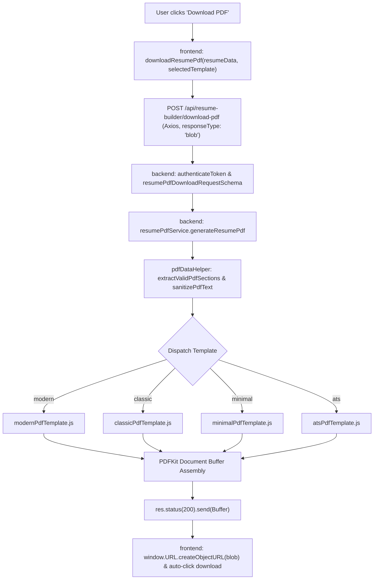

# Module 8 — Lesson 8.5: Enhanced Resume PDF Download

## 1. Lesson Objective

The primary objective of **Lesson 8.5** is to provide seamless, high-fidelity PDF generation and download capabilities for the existing AI Resume Builder. Users can edit resume data, select from any of the four available resume templates (`modern`, `classic`, `minimal`, `ats`), view live updates in the simulated preview pane, and trigger instant PDF generation and download to their local device.

---

## 2. Existing Architecture Inspected

- **Frontend Builder Layout**: `frontend/src/pages/dashboard/ResumeBuilder.jsx` houses dynamic forms and the live preview component.
- **Form State**: `useResumeForm.js` and `resumeBuilderValidation.js` maintain structured candidate details across 8 sections: Personal Info, Professional Summary, Skills, Work Experience, Education, Projects, Certifications, and Achievements.
- **Presentation Layer**: `ResumePreview.jsx` and `TemplateRenderer.jsx` isolate template presentation (`selectedTemplate`) from candidate data (`resumeData`).
- **Backend Architecture**: Express.js server (`backend/app.js`) with JWT authentication middleware (`authenticateToken`), Zod schema validators (`backend/validators/`), and modular service architecture (`backend/services/`).

---

## 3. PDFKit Installation & Compatibility

- **Package**: `pdfkit`
- **Installed Version**: `^0.21.0`
- **Installation Target**: Backend only (`backend/package.json`). PDFKit is strictly maintained in the Node.js backend environment to prevent frontend bundle bloat.
- **Node.js Environment**: Tested on Node.js v24.17.0 with native ES modules (`import PDFDocument from "pdfkit"`).

---

## 4. Files Created and Modified

### Backend Files Created:
1. `backend/services/pdfTemplates/pdfDataHelper.js`:
   - Text sanitization (`sanitizePdfText`) ensuring compatibility with PDFKit's standard Latin-1/WinAnsi fonts.
   - Dynamic non-empty section extraction (`extractValidPdfSections`).
   - Space and page-break utility (`ensureSpace`).
   - Safe alphanumeric filename generator (`sanitizeFilename`).
2. `backend/services/pdfTemplates/modernPdfTemplate.js`:
   - Modern layout with bold header, blue accents (`#2563eb`), bullet/bar separators, and structured sections.
3. `backend/services/pdfTemplates/classicPdfTemplate.js`:
   - Traditional corporate layout with Times-Roman serif typography, centered contact block, and formal horizontal rules.
4. `backend/services/pdfTemplates/minimalPdfTemplate.js`:
   - Scandinavian-inspired layout with generous whitespace, light typography, and subtle uppercase headings.
5. `backend/services/pdfTemplates/atsPdfTemplate.js`:
   - Strict single-column layout with standard ATS section headings, plain text bullets, and zero parsing obstacles.
6. `backend/services/resumePdfService.js`:
   - Master PDF generation orchestrator returning a binary `Buffer`.
   - Manages A4 page setup, margins, multi-page numbering, and error handling.
7. `backend/validators/resumePdfDownloadSchema.js`:
   - Zod schema validating `selectedTemplate` and comprehensive `resumeData` payload structures.
8. `backend/tests/resumePdfDownload.test.js`:
   - 15 automated backend tests verifying PDF generation, all four templates, multi-page pagination, unicode handling, and API endpoints.

### Backend Files Modified:
1. `backend/controllers/resumeBuilderController.js`:
   - Added `downloadResumePdf` controller endpoint with auth verification, schema validation, and PDF binary response streaming.
2. `backend/routes/resumeBuilderRoutes.js`:
   - Added `POST /download-pdf` route protected by `authenticateToken`.
3. `backend/package.json`:
   - Added `pdfkit` dependency (`^0.21.0`) and `test:pdf-download` script.

### Frontend Files Created:
1. `frontend/src/services/resumeBuilderService.js`:
   - Exports `downloadResumePdf(resumeData, selectedTemplate)`: sends POST request with `responseType: "blob"`, handles object URLs, and triggers temporary anchor download.
2. `frontend/src/components/builder/DownloadResumeButton.jsx`:
   - Reusable download button with loading spinner, disabled state during generation, and floating status notices.
3. `frontend/tests/resumePdfDownload.test.js`:
   - 5 automated unit tests validating filename sanitization, template propagation, blob validation, and error parsing.

### Frontend Files Modified:
1. `frontend/src/pages/dashboard/ResumeBuilder.jsx`:
   - Integrated `DownloadResumeButton` into top actions header.
   - Updated header badges to Module 8.5.
2. `frontend/src/components/builder/ResumePreview.jsx`:
   - Integrated compact `DownloadResumeButton` in the preview sheet header.
3. `frontend/package.json`:
   - Added `test:pdf-download` into the `test` script chain.

---

## 5. PDF Generation Architecture



---

## 6. Template-Specific PDF Behavior

| Template | Typography & Palette | Structure & Key Characteristics | ATS Optimization |
| :--- | :--- | :--- | :--- |
| **Modern** | Helvetica / Helvetica-Bold<br>Slate 900, Blue 600 accent | Clean contemporary layout with blue timeline accent bars, right-aligned dates, and bulleted skills. | High readability |
| **Classic** | Times-Roman / Times-Bold (Serif)<br>Neutral Charcoal, Dark Gray | Traditional executive design with centered header block, full-width dividers, and formal typography. | Standard parser compatible |
| **Minimal** | Helvetica Light<br>Slate 800, Slate 500 headers | Generous margins and vertical whitespace, understated uppercase titles, minimalist divider line. | Clean text hierarchy |
| **ATS-Friendly** | Standard Helvetica<br>High-contrast Black & White | Strict single-column layout, standard uppercase headings (`WORK EXPERIENCE`, `SKILLS`, etc.), plain text bullets, no tables/graphics. | Maximum ATS compliance |

---

## 7. API Endpoint & Request Format

### Endpoint:
`POST /api/resume-builder/download-pdf`

### Headers:
- `Content-Type: application/json`
- `Accept: application/pdf`
- `Cookie` / `Authorization: Bearer <token>`

### Request Body:
```json
{
  "selectedTemplate": "modern",
  "resumeData": {
    "resumeTitle": "Full Stack Engineer Resume",
    "personalInfo": {
      "fullName": "Jane Doe",
      "email": "jane@example.com",
      "phone": "+1 (555) 019-2834",
      "location": "San Francisco, CA",
      "linkedIn": "https://linkedin.com/in/janedoe",
      "gitHub": "https://github.com/janedoe",
      "portfolio": "https://janedoe.dev"
    },
    "professionalSummary": "Experienced developer...",
    "skills": ["React", "Node.js", "Express", "MySQL"],
    "experience": [...],
    "education": [...],
    "projects": [...],
    "certifications": [...],
    "achievements": [...]
  }
}
```

### Response Headers:
- `Content-Type: application/pdf`
- `Content-Disposition: attachment; filename="jane_doe_modern.pdf"`
- `Content-Length: <byte_size>`

---

## 8. Security, Validation & Unicode Handling

1. **Authentication**: All download requests require authenticated session tokens (`authenticateToken`).
2. **Input Validation**: Validated against `resumePdfDownloadRequestSchema` enforcing character boundaries and supported template IDs.
3. **Empty Resume Rejection**: Blank resumes are rejected with HTTP 422 (`EMPTY_RESUME`) to prevent generation of blank PDFs.
4. **Text & Typographical Sanitization**: `sanitizePdfText` converts Unicode smart quotes (`’`, `“`, `”`), en/em dashes (`–`, `—`), and non-breaking spaces into ASCII-compatible characters, preventing PDFKit encoding faults.
5. **Memory Safety**: PDFs are generated as in-memory buffers returned immediately in the HTTP stream; no temporary files are persisted to the server disk.

---

## 9. Verification & Commands

### Running Backend Tests:
```bash
cd backend
npm run test:pdf-download
```

### Running Frontend Tests:
```bash
cd frontend
npm run test:pdf-download
```

### Running Complete Verification:
```bash
npm --prefix backend test
npm --prefix frontend test
npm --prefix frontend run lint
npm --prefix frontend run build
```
